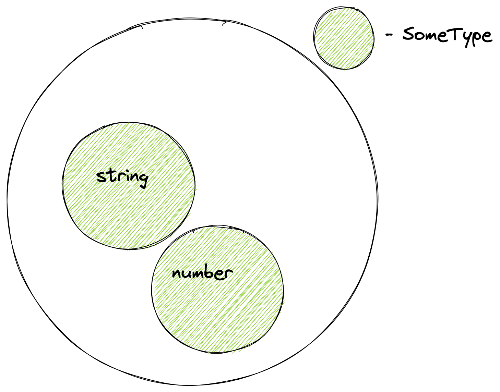

En esta lección conoceremos los tipos de datos y veremos por qué son útiles para el desarrollador. También hablaremos de los tipos como conjuntos. Esto te permitirá entender los principios de funcionamiento de TypeScript.

## Tipos de datos

La familia de lenguajes que no tiene tipos de datos se llama **ensamblador**. Estos lenguajes trabajan directamente con el procesador y operan con sus registros. Los registros almacenan valores que, desde el punto de vista del lenguaje, son números, y lo que está codificado detrás de ese número lo debe determinar el propio programador. Puede ser una cadena o una parte de una imagen.

El principal problema de este enfoque es la falta de seguridad. El programa no mostrará un error si por accidente hacemos algo incorrecto con una cadena. Desde el punto de vista del procesador y del lenguaje de programación, no existe la cadena: hay un número y realizamos ciertas operaciones con él. Como resultado, el programa siempre funciona, pero el resultado es incorrecto. Programar en este modo exige un alto nivel de atención.

La situación mejoró cuando aparecieron los tipos de datos en los lenguajes de alto nivel. Permitieron resolver dos tareas:

- describir y limitar el conjunto de todos los valores de un tipo concreto
- definir las operaciones que se pueden realizar con ese tipo

Un **tipo de dato** es el conjunto de todos los valores y el conjunto de operaciones permitidas sobre ellos. Así se imponen restricciones al código: los números se suman y se restan, las cadenas se concatenan y en ellas se buscan subcadenas. Esto proporciona **seguridad de tipos** y descarta una parte de los errores incluso antes de ejecutar el programa.

Incluso en un lenguaje dinámico como JavaScript hay tipos, y la seguridad es mayor que en ensamblador, donde los datos son simplemente una secuencia de bits. En TypeScript, que es estático, las restricciones sobre los datos se definen con más precisión, por lo que la verificación también es más estricta.

## Conjuntos

Si hablamos de los tipos de datos como conjuntos de valores permitidos, por un lado, puede tratarse de limitar un número por un límite superior y uno inferior. Por ejemplo, así funciona en JavaScript. Tenemos `Number` para un rango de números y `BigInt` para otro, cuando necesitamos trabajar con números enormes. Por otro lado, hablamos de conjuntos.

Ver los tipos como conjuntos juega un papel importante. Esto se debe a que el sistema de tipos de TypeScript sabe combinar tipos de la misma manera que se hace con los conjuntos normales. Por ejemplo, podemos unir dos conjuntos de tipos y obtener un nuevo tipo que incluye todos los elementos del primer conjunto y del segundo. Así aparece el Union Type:

```typescript
type SomeType = number | string;
const v1: SomeType = 1;
const v2: SomeType = "hexlet";
```



De manera parecida se pueden construir la intersección y la extensión de tipos y realizar otras operaciones con ellos. Algunas las veremos en el curso, pero otras quedarán fuera de su alcance. Lo principal es acostumbrar tu forma de pensar a las operaciones con tipos. Así será más fácil entender los principios de funcionamiento de TypeScript y recordar cierto comportamiento.
