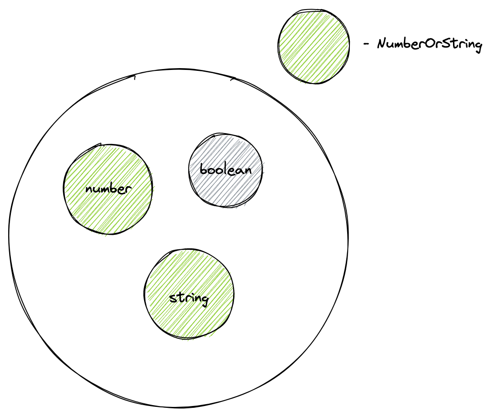

En esta lección aprenderemos a trabajar con las uniones de tipos, que desempeñan un papel importante en TypeScript. Permiten expresar una situación habitual en JavaScript, cuando el valor de retorno o el argumento de una función pueden ser de distintos tipos. Por ejemplo, el método `String.prototype.at()` puede devolver un valor de tipo `string` o `undefined`.

La unión se indica con el operador de barra vertical `|`, a cuyos lados se colocan los tipos.

Definamos nuestro propio tipo para la función `at`:

```typescript
type at = (str: string, position: number) => string | undefined;
```

Desde el punto de vista de la teoría de conjuntos, la operación _union_ significa unión. Cuando unimos varios conjuntos, obtenemos un nuevo conjunto que contiene todos los elementos de los conjuntos originales.

En TypeScript, esto significa que obtenemos un tipo que promete contener una variable de uno de los tipos de la unión. Así podemos crear nuestro propio tipo que abarque todas las cadenas **O** los números:

```typescript
type NumberOrString = number | string;

let val: NumberOrString = 10; // OK
val = "My string"; // OK
val = true; // Type 'boolean' is not assignable to type 'NumberOrString'.
```



En la práctica, a menudo hay casos en los que necesitamos que una función admita una gran cantidad de valores permitidos. En JavaScript, podemos concatenar una cadena no solo con otra cadena, sino también con un número o con valores booleanos. Para resolver una tarea parecida, en lecciones anteriores conocimos la sobrecarga de funciones. Describamos el tipo de una función así usando una unión:

```typescript
type AllowedToConcatenation = number | string | null | undefined | boolean;

const concat = (base: AllowedToConcatenation, suffix: AllowedToConcatenation): string =>
  `${base}${suffix}`;
```

Para describir todos los valores permitidos de la función `concat()` mediante sobrecarga, tendríamos que escribir código para cada caso por separado. Aquí, en cambio, describimos el tipo `AllowedToConcatenation` mediante una unión una sola vez y lo usamos en dos lugares.

Los Union Types se usan en todas partes donde el programador quiere decir que una variable puede contener valores de tipos distintos, pero descritos de antemano. Para indicar tipos arbitrarios se puede usar `unknown` o los genéricos, que veremos más adelante.
