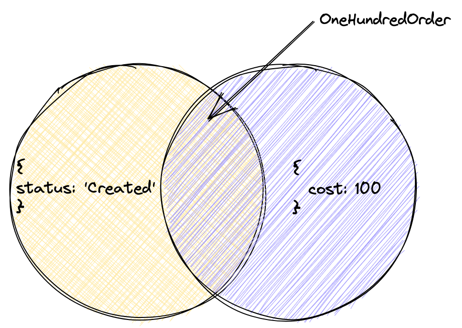

Junto con la unión, otra operación importante en la teoría de conjuntos es la intersección. A los desarrolladores acostumbrados al dinamismo de JavaScript, esta operación puede parecerles menos significativa. Pero no se puede prescindir de ella, por ejemplo, al describir el tipo de una fusión de objetos.

La intersección se indica con el símbolo `&`, a cuyos lados se colocan los tipos.

Definamos el tipo de un objeto con el estado del pedido y luego un tipo más estricto con un precio exacto:

```typescript
type Order = {
  status: "Created";
};

type OneHundredOrder = Order & {
  cost: 100;
};

const myOrder: OneHundredOrder = {
  status: "Created",
  cost: 100,
};
```

De la intersección de tipos de objeto con los campos `status` **Y** `cost` obtuvimos el tipo `OneHundredOrder`, que contiene ambos campos.

Un tipo es un conjunto de valores. Cuando definimos una intersección de tipos, obtenemos un nuevo tipo que contiene los valores que cumplen las restricciones de ambos tipos.



Si declaramos la variable `const StringAndNumber: string & number`, habrá que asignarle un valor que pertenezca a la vez a los conjuntos `string` y `number`. Es decir, que sea al mismo tiempo una cadena y un número. Ese valor no existe, por lo que `StringAndNumber` tendrá el tipo `never`. `never` corresponde al conjunto vacío: un tipo que no tiene ningún valor.
