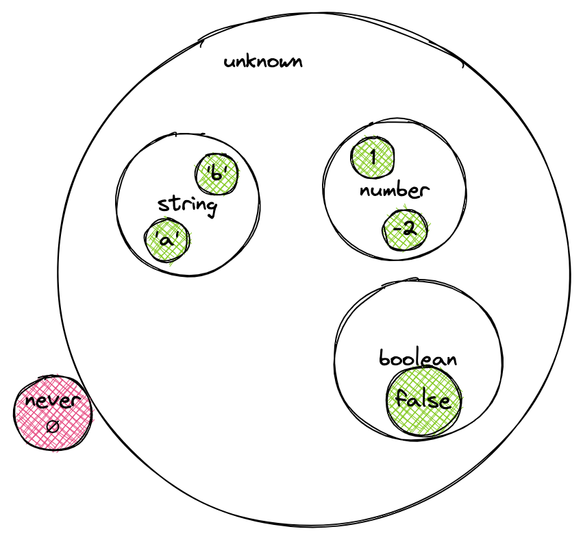

En esta lección analizaremos la relación entre los tipos, que se organiza en una jerarquía.

## Tipos como subconjuntos

Veamos un ejemplo del error _Type X is not assignable to type Y_ en una función para ordenar elementos. Supongamos que ya tenemos escrita la función `sort`. Para describir solo sus tipos, usaremos la palabra clave `declare`:

```typescript
type ComparatorCallback = (item1: number, item2: number, index: number) => -1 | 0 | 1;
declare function sort(arr: Array<number>, callback: ComparatorCallback): Array<number>;

const arr = [1, 2, 3];
const comparator = (item1: number, item2: number) => Math.sign(item1 - item2);

sort(arr, comparator); // Error: Type 'number' is not assignable to type '0 | 1 | -1'.
```

La comprobación de tipos dio un error: la unión de tipos literales `0 | 1 | -1` no es compatible con el tipo `number`. Podría parecer que el sistema de tipos se equivoca y que conviene usar `any`. Pero si pensamos en los tipos literales numéricos como subconjuntos de `number`, todo cobra sentido.

Aquí se ve claramente la relación de los tipos con la teoría de conjuntos. Un conjunto `A` es un subconjunto de `B` si todo elemento que pertenece a `A` también pertenece a `B`. Así obtenemos relaciones entre los tipos, que se organizan en una jerarquía de tipos. Esto ayuda a entender si es posible asignar una variable de un tipo a una variable de otro tipo.

## Tipos literales

Recordemos que los tipos literales existen para cuatro tipos de datos:

- `boolean`
- `string`
- `number`
- `BigInt`

En consecuencia, cualquier tipo literal se puede asignar a una variable del tipo correspondiente:

```typescript
let num: number = 1;
const two: 2 = 2;
const notTrue: false = false;

num = two;
num = notTrue; // Type 'boolean' is not assignable to type 'number'.
```

Aquí `2` se usa como un tipo literal que representa un conjunto de un solo elemento: el dos.

El analizador aceptó sin problemas la asignación del tipo literal numérico a `number`, pero el tipo literal `boolean` ya no pudimos asignarlo. Para resolver este problema, se puede usar la unión de tipos `number | boolean`. Pero si no estamos seguros de qué se puede asignar, tendríamos que hacer una unión con una cantidad potencialmente enorme de tipos.

En este caso nos ayuda el tipo `unknown`.

## Tipo unknown

El tipo `unknown` es un superconjunto de todos los tipos disponibles. Permite asignar a una variable un valor de cualquier tipo:

```typescript
let unknownValue: unknown = 1;

unknownValue = 2; // OK
unknownValue = false; // OK
unknownValue = "string"; // OK
```

Puede parecer que el tipo `unknown` funciona igual que `any`. Sin embargo, hay una diferencia entre ellos. El tipo `any` básicamente desactiva la comprobación de tipos y permite realizar cualquier operación con el valor, por ejemplo, acceder a las propiedades de la variable. El tipo `unknown` lo prohíbe y exige comprobar antes el tipo de la variable o convertirla al tipo necesario:

```typescript
let unknownValue: unknown;

unknownValue = "string";
unknownValue.toUpperCase(); // Error: Property 'toUpperCase' does not exist on type 'unknown'.
```

Aquí pudimos asignar una cadena a la variable `unknownValue`, pero no podemos llamar al método `toUpperCase()`, porque el compilador no sabe que la variable contiene una cadena. Para llamar al método, primero hay que comprobar el tipo de la variable.

Otra propiedad importante: al unir cualquier tipo con `unknown` siempre obtenemos `unknown`:

```typescript
type UnionWithUnknown = unknown | number | boolean;
```

Esto ocurre porque `unknown` es un superconjunto de todos los tipos, así que cualquier unión con él da el propio `unknown`. La excepción es `any`: también en este caso desactiva la comprobación de tipos y no se somete al modelo de tipos como conjuntos.

A continuación veremos el caso en el que no necesitamos asignar ningún valor a una variable.

## Tipo never

A veces, en la práctica, hay que estar seguro de que a una variable no se le asignará ningún valor. Esto se puede lograr con el tipo `never`:

```typescript
let neverValue: never;
const two: 2 = 2;

neverValue = two; // Type 'number' is not assignable to type 'never'
```

El error aparece porque `never` es un conjunto vacío, sin ningún elemento. Por eso a la variable `neverValue` no se le puede asignar ningún valor.

## Conjuntos de tipos

Con lo que sabemos hasta ahora, podemos construir la siguiente imagen de los conjuntos de tipos de TypeScript:



El conjunto `number` también incluye todas las uniones de tipos literales numéricos, y el conjunto `string`, las de cadenas literales:

```typescript
type NumberUnion = -2 | -1 | 1 | 2;

const one: NumberUnion = 1;
const num: number = one;

type StringUnion = "a" | "b" | "c" | "d";

const aChar: StringUnion = "a";
const str: string = aChar;
```

Este subconjunto de tipos se llama subtipo, y el conjunto en sí, supertipo.

Las relaciones entre subtipos y supertipos son un concepto clave de cualquier lenguaje con tipado estático. Forman una jerarquía de tipos. Esto se vuelve especialmente importante cuando queremos convertir un tipo en otro.

## Conversión de tipos

Veamos las distintas formas de convertir tipos:

```typescript
const num = 1; // Conversión ascendente implícita
const one: number = 1; // Conversión ascendente explícita

const two = num as 2; // Conversión descendente explícita

const three = 3 as const; // Conversión a tipo literal: descendente
```

Cuando asignamos un valor a una variable o pasamos argumentos a una función, TypeScript intenta hacer una conversión ascendente, es decir, del subtipo al tipo base. También se puede indicar explícitamente una conversión ascendente. Ya usamos esta posibilidad para comprobar si se puede convertir un tipo en otro o para indicar explícitamente qué tipo de variable esperamos.

La conversión de un tipo base a un subtipo se hace explícitamente con `as`. En este caso, TypeScript da la conversión de tipos por verdadera. En algunos casos esto puede provocar errores. Por eso la conversión descendente se considera insegura. Este código hay que revisarlo con atención.

Veamos otro ejemplo:

```typescript
const args = [8, 5]; // args: number[]
const angle = Math.atan2(...args); // error! A spread argument must either have a tuple type or be passed to a rest parameter.
console.log(angle);
```

Aquí el compilador asigna a la variable `args` el tipo `number[]`: un array con cualquier cantidad de elementos numéricos. El compilador amplió los valores posibles del array, aunque solo indicamos dos elementos. Esto es precisamente una conversión ascendente implícita, cuando el compilador convierte a un tipo más general.

Por esta razón aparece el error, porque el método `Math.atan2()` espera dos argumentos, y el tipo de la variable `args` puede contener cualquier cantidad de elementos. Aquí no hace falta ninguna conversión: basta con nombrar el tipo como una tupla desde el principio, y el compilador no tendrá nada que ampliar:

```typescript
const args: [number, number] = [8, 5];
const angle = Math.atan2(...args); // okay
console.log(angle);
```

Una tupla fija la cantidad de elementos, pero no prohíbe cambiarlos, y el tipo de cada elemento sigue siendo `number`:

```typescript
args[0] = 100; // okay
```

Si los valores no deben cambiar, se usa la conversión descendente `as const`:

```typescript
const args = [8, 5] as const; // readonly [8, 5]

args[0] = 100; // Error: Cannot assign to '0' because it is a read-only property.
```

Ahora el tipo de la variable no es "dos números", sino "un ocho y un cinco que no se pueden reescribir". Este conjunto es más pequeño que `number[]`, y por eso la conversión se llama descendente: pasamos de un tipo más amplio a uno más estrecho, que contiene menos valores posibles.

La anotación con una tupla y `as const` resuelven tareas distintas. La primera nombra el tipo que necesitamos. La segunda le prohíbe al compilador ampliar lo que ya está escrito en el código.
