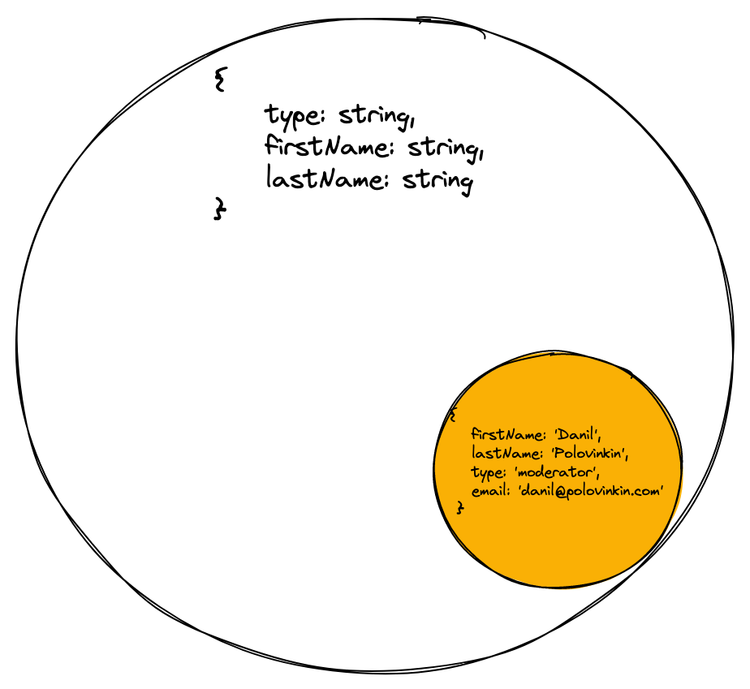
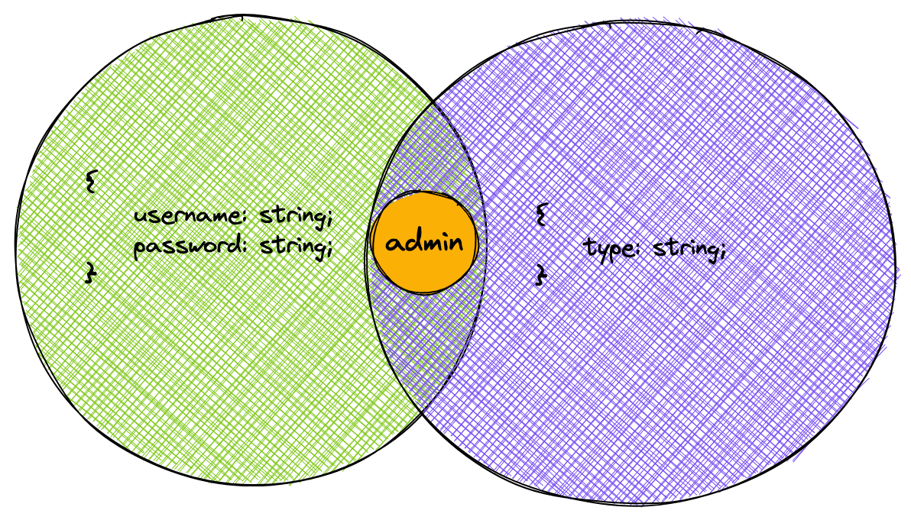

En JavaScript se puede trabajar con objetos y clases de la misma manera. Para ello no hace falta apoyarse ni en la herencia ni en las interfaces. Solo se necesitan los campos y métodos esperados. Este enfoque se llama **tipado pato** (_duck typing_). Si algo camina como un pato y hace cuac como un pato, entonces es un pato:

```javascript
const user = {
  firstName: "Vasiliy",
  lastName: "Kuzenkov",
  type: "user",
};

const admin = {
  firstName: "Kirill",
  lastName: "Mokevnin",
  type: "admin",
};

const formatUser = (user) => [user.type, ":", user.firstName, user.lastName].join(" ");

formatUser(user); // 'user : Vasiliy Kuzenkov'
formatUser(admin); // 'admin : Kirill Mokevnin'
```

En lenguajes como Java tendríamos que definir una interfaz y luego implementarla por separado para las clases `User` y `Admin`. Y en los parámetros del método de formateo, el tipo del argumento sería esa interfaz.

Otra opción es escribir un método con sobrecarga para estos dos casos. Los lenguajes con este comportamiento usan el tipado nominativo (_nominative typing_).

Para organizar el enfoque del tipado pato en Java, hay que escribir mucho código adicional.

Para facilitar el paso de JavaScript a TypeScript y usar comprobaciones antes de ejecutar el código, se eligió el enfoque del tipado estructural. Es el que conoceremos en esta lección.

Con el tipado estructural podemos reescribir fácilmente nuestro ejemplo en TypeScript:

```typescript
const user = {
  firstName: "Vasiliy",
  lastName: "Kuzenkov",
  type: "user",
};

const admin = {
  firstName: "Kirill",
  lastName: "Mokevnin",
  type: "admin",
};

type User = {
  type: string;
  firstName: string;
  lastName: string;
};

const formatUser = (user: User): string =>
  [user.type, ":", user.firstName, user.lastName].join(" ");

formatUser(user); // 'user : Vasiliy Kuzenkov'
formatUser(admin); // 'admin : Kirill Mokevnin'
```

Creamos el tipo `User`, que describe la estructura esperada del objeto. Además, en la función `formatUser` indicamos que el argumento esperado debe corresponder al tipo `User`. Así, la función `formatUser` solo acepta objetos que contienen todos los campos del tipo de objeto `User`.

Es importante recordar que el tipado estructural no nos protege de que el objeto tenga campos adicionales:

```typescript
const moderator = {
  firstName: "Danil",
  lastName: "Polovinkin",
  type: "moderator",
  email: "danil@polovinkin.com",
};

type User = {
  type: string;
  firstName: string;
  lastName: string;
};

const formatUser = (user: User): string =>
  [user.type, ":", user.firstName, user.lastName].join(" ");

formatUser(moderator); // 'moderator : Danil Polovinkin'
```

Aunque no indicamos el campo `email` en el tipo `User`, TypeScript igualmente no dará error, ya que el objeto `moderator` tiene todos los campos descritos en el tipo `User`.

En el tipado estructural, se puede pensar en un tipo de objeto como en una descripción de la estructura que impone restricciones a los valores que se asignan. O como en un conjunto de objetos que se pueden asignar a una variable con ese tipo.



Cuantos menos campos tenga el tipo de objeto, menos específica es la restricción que se impone al valor asignado. En términos de conjuntos, esto significa que un tipo de objeto con campos adicionales será un subconjunto del tipo de objeto sin esos campos. Si hablamos del estrechamiento y la ampliación de tipos en los tipos de objeto, los campos adicionales estrechan el tipo.

De forma análoga a las operaciones con conjuntos, para los tipos de objeto se puede entender la intersección y la unión en el tipado estructural.

Con la unión `|` ampliamos el tipo: aumentamos la cantidad de valores permitidos para el tipo. Y con la intersección `&`, lo estrechamos. Así reducimos la cantidad de valores permitidos:

```typescript
type IntersectionUser = {
  username: string;
  password: string;
} & {
  type: string;
};

// Se requiere coincidencia con el tipo de objeto tanto a la izquierda como a la derecha del operador &
const admin: IntersectionUser = {
  username: "test",
  password: "test",
  type: "admin",
};

type UnionUser =
  | {
      username: string;
      password: string;
    }
  | {
      type: string;
    };

// Basta con coincidir con uno de los tipos de objeto
const user: UnionUser = { username: "test", type: "user" };
```

El tipo resultante `IntersectionUser` describe objetos que contienen los campos `username`, `password` y `type`. Y el tipo `UnionUser`, objetos que contienen los campos `username` y `password` **O** `type`.



En el álgebra de conjuntos, la intersección de dos conjuntos también se llama multiplicación lógica. Y para los tipos se usa el término producto de tipos. La unión de conjuntos, en cambio, se llama suma lógica, y para los tipos, suma de tipos.

Intenta responder qué pasará si en una intersección usas dos tipos de objeto con el mismo nombre de campo, pero con tipos distintos. Es un error frecuente por falta de atención o por no entender bien los tipos como conjuntos.

<details>
<summary>Respuesta</summary>
Cuando al intersectar tipos de objeto aparecen campos con el mismo nombre, los tipos de esos campos también se intersectan. Si son incompatibles, el tipo resultante del campo pasa a ser <code>never</code>.
</details>

Al usar tipos unión en funciones, hay que tener en cuenta lo siguiente. Veamos un ejemplo:

```typescript
const user: UnionUser = { username: "test", type: "user" };

const func = (user: UnionUser) => {
  console.log(user.type);
};
```

El compilador dará un error, ya que el tipo de la variable `user` puede corresponder tanto al tipo de la izquierda como al de la derecha. Como resultado, no hay garantía de que el objeto `user` tenga cualquiera de las propiedades.

El error se elimina con un campo común de tipo literal. Si cada variante de la unión tiene un campo `type` con su propio valor, la comprobación de ese campo estrecha el tipo a una sola variante.

```typescript
type Shape = { type: "circle"; radius: number } | { type: "square"; side: number };

const getArea = (shape: Shape): number => {
  switch (shape.type) {
    case "circle":
      return Math.PI * shape.radius ** 2;
    case "square":
      return shape.side ** 2;
  }
};

getArea({ type: "square", side: 3 }); // 9
```

Dentro de la rama `case "circle"`, TypeScript sabe que `shape` tiene el campo `radius`. Acceder a `shape.side` en esta rama dará un error de compilación, porque el círculo no tiene ese campo.
