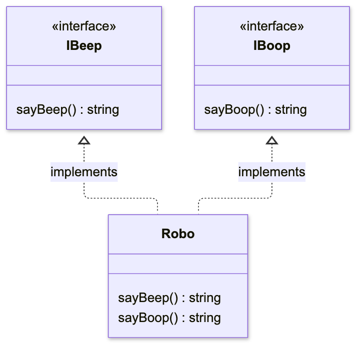

In this lesson, we will study how classes implement interfaces. We will examine how one class satisfies the requirements of several interfaces. We will learn to distinguish interface checking from inheriting implemented methods.

## Implementing several interfaces

A class can implement several interfaces using `implements`. TypeScript checks that the class contains all their required properties and methods.

```typescript
interface IBeep {
  sayBeep: () => string;
}

interface IBoop {
  sayBoop: () => string;
}

class Robo implements IBeep, IBoop {
  sayBeep = () => "beep";

  sayBoop = () => "boop";
}

const R2D2 = new Robo();
R2D2.sayBeep(); // 'beep'
```

The `Robo` class implements two interfaces. The diagram shows the methods each interface requires and where they are implemented.



Dashed arrows with triangular heads point from the class to the interfaces it implements. We wrote both functions inside `Robo`. The `implements` clause checks their presence and types without adding any method implementations.

## Creating classes based on interfaces

Interfaces can extend other interfaces using `extends`. A class uses `implements` to declare that it satisfies an interface. This check does not create properties or methods in the class.

If we create an interface or type and then transpilate TypeScript into JavaScript, there will be no sample of that interface left in the code. At the same time, when we create a class, its sample is always transpiled into JavaScript.

It turns out that the option with interfaces is more lightweight, but still the choice should depend on the problem we are solving.

Creating a class based on an interface does not lead to an exact implementation of that interface in the class. TypeScript simply checks if the properties and methods of our class satisfy the properties declared in the interface. We write the class itself manually.

Let's look at an example:

```typescript
interface ICalculate {
  sum: (num1: number, num2: number) => number;
}

class Summator implements ICalculate {
  sum(num1, num2) {
    return num1 + num2;
  }
  // For parameters the following message will be displayed: Parameter 'num1'/'num2' implicitly has an 'any' type,
  // because TypeScript only checks the class against the interface, but does not fully inherit from it.
  multiply(num1: number, num2: number) {
    return num1 * num2;
  }
  // We added a new method, but TypeScript doesn't complain
}

let calculator = new Summator();
// Our code will work as if it worked for arguments with type any,
// because parameter types, as well as everything else, were not inherited by the class when the interface was implemented
calculator.sum(2, 3); // 5
```

An error in the implementation of an interface by a class is possible only when we do not implement one of the properties specified in the interface. Or we implement it differently than specified in the interface:

```typescript
interface ICalculate {
  sum: (num1: number, num2: number) => number;
}

class Summator implements ICalculate {
  sum(num1: string, num2: string) {
    return num1 + num2;
  }
  // We changed the argument types to string, i.e. we implemented the interface incorrectly
  // In this case TypeScript will notice our error and will not compile:
  // Type '(num1: string, num2: string) => string' is not assignable to type '(num1: number, num2: number) => number'.
}
```

For the same reason, if we write a class that implements an interface with optional properties, we need to write everything ourselves. Otherwise, these properties will not be included in our class:

```typescript
interface ICalculate {
  sum: (num1: number, num2: number) => number;
  multiply?: (num1: number, num2: number) => number;
}

class Summator implements ICalculate {
  sum(num1: number, num2: number) {
    return num1 + num2;
  }
}

const calculator = new Summator();
calculator.sum(2, 3); // 5
calculator.multiply(2, 3); // Property 'multiply' does not exist on type 'Summator'.
```

In the example above, we specified only the `sum` method when implementing the interface with the `Summator` class. As a result, the code compiled successfully because the `multiply` method was specified as optional. At the same time, we cannot address this method in an instance of our class.

## Conclusions

Since there are several different tools in TypeScript for the same things, we can implement classes using abstract class extensions instead of interfaces. But the choice will depend on the task at hand. Abstract classes provide us with access modifiers and constructors, while interfaces are more lightweight and simple.
