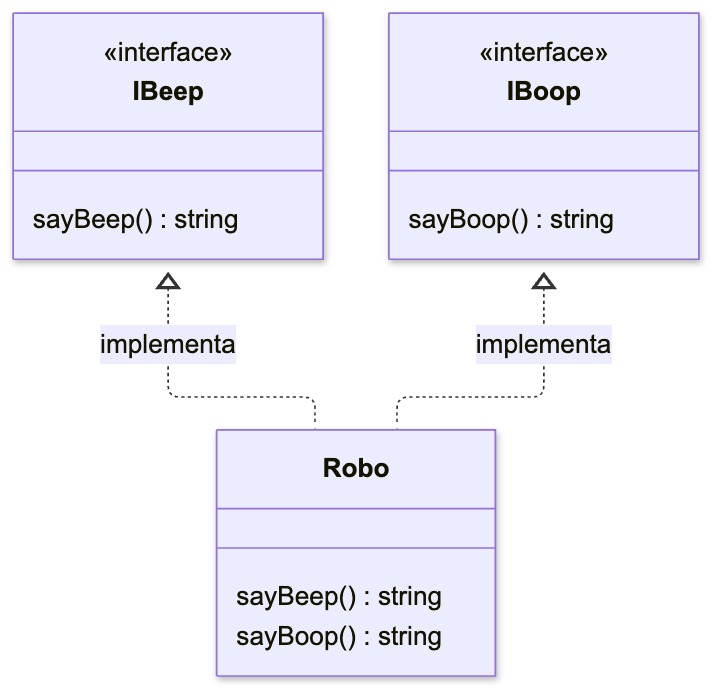

En esta lección estudiaremos cómo las clases implementan interfaces. Veremos cómo una clase cumple los requisitos de varias interfaces. Aprenderemos a distinguir la comprobación de una interfaz de la herencia de métodos ya implementados.

## Implementación de varias interfaces

Una clase puede implementar varias interfaces mediante `implements`. TypeScript comprueba que la clase contenga todas las propiedades y los métodos obligatorios de esas interfaces.

```typescript
interface IBeep {
  sayBeep: () => string;
}

interface IBoop {
  sayBoop: () => string;
}

class Robo implements IBeep, IBoop {
  sayBeep = () => "beep";

  sayBoop = () => "boop";
}

const R2D2 = new Robo();
R2D2.sayBeep(); // 'beep'
```

La clase `Robo` implementa dos interfaces. El diagrama muestra los métodos que exige cada una y dónde se encuentra su implementación.



Las flechas discontinuas con triángulo apuntan desde la clase hacia la interfaz que implementa. Escribimos ambas funciones dentro de `Robo`. `implements` comprueba su presencia y sus tipos, pero no añade el código de los métodos.

## Creación de clases basadas en interfaces

Las interfaces pueden extender otras interfaces mediante `extends`. Una clase declara mediante `implements` que cumple los requisitos de una interfaz. Esta comprobación no crea propiedades ni métodos en la clase.

Si creamos una interfaz o un tipo y luego transpilamos TypeScript a JavaScript, en el código no quedará rastro de esa interfaz. En cambio, cuando creamos una clase, su plantilla siempre pasa a JavaScript durante la transpilación.

Por tanto, la opción con interfaces es más ligera, pero la elección debe depender del problema que estemos resolviendo.

Crear una clase basada en una interfaz no implementa esa interfaz en la clase de forma automática. TypeScript solo comprueba si las propiedades y los métodos de nuestra clase cumplen con las propiedades declaradas en la interfaz. La clase en sí la escribimos a mano.

Veamos un ejemplo:

```typescript
interface ICalculate {
  sum: (num1: number, num2: number) => number;
}

class Summator implements ICalculate {
  sum(num1, num2) {
    return num1 + num2;
  }
  // Para los parámetros se mostrará el mensaje: Parameter 'num1'/'num2' implicitly has an 'any' type,
  // porque TypeScript solo comprueba que la clase coincida con la interfaz, pero no hereda de ella por completo

  multiply(num1: number, num2: number) {
    return num1 * num2;
  }
  // Hemos agregado un nuevo método, pero TypeScript no protesta
}

let calculator = new Summator();
// Nuestro código funcionará como si los argumentos fueran de tipo any,
// porque los tipos de los parámetros, al igual que todo lo demás, no los heredó la clase al implementar la interfaz
calculator.sum(2, 3); // 5
```

Un error en la implementación de la interfaz por la clase solo es posible cuando no implementamos una de las propiedades especificadas en la interfaz. O cuando la implementamos de forma distinta a como está indicado en la interfaz:

```typescript
interface ICalculate {
  sum: (num1: number, num2: number) => number;
}

class Summator implements ICalculate {
  sum(num1: string, num2: string) {
    return num1 + num2;
  }
  // Hemos cambiado los tipos de los argumentos a string, es decir, hemos implementado mal la interfaz
  // En este caso, TypeScript detectará nuestro error y no compilará:
  // Type '(num1: string, num2: string) => string' is not assignable to type '(num1: number, num2: number) => number'.
}
```

Por la misma razón, si escribimos una clase que implementa una interfaz con propiedades opcionales, tenemos que escribirlo todo nosotros mismos. De lo contrario, estas propiedades no llegarán a nuestra clase:

```typescript
interface ICalculate {
  sum: (num1: number, num2: number) => number;
  multiply?: (num1: number, num2: number) => number;
}

class Summator implements ICalculate {
  sum(num1: number, num2: number) {
    return num1 + num2;
  }
}

const calculator = new Summator();
calculator.sum(2, 3); // 5
calculator.multiply(2, 3); // Property 'multiply' does not exist on type 'Summator'.
```

En el ejemplo anterior solo especificamos el método `sum` al implementar la interfaz con la clase `Summator`. Como resultado, el código se compiló con éxito, ya que el método `multiply` estaba indicado como opcional. Sin embargo, en la instancia de nuestra clase no podemos acceder a este método.

## Conclusiones

Como en TypeScript existen varias herramientas diferentes para las mismas cosas, podemos implementar clases extendiendo clases abstractas en lugar de interfaces. Pero la elección dependerá de la tarea. Las clases abstractas nos proporcionan modificadores de acceso y constructores, mientras que las interfaces son más ligeras y sencillas.
