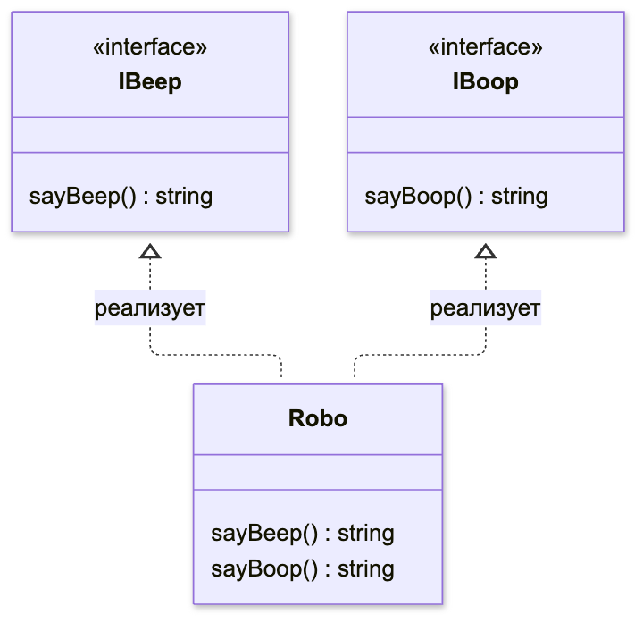

В этом уроке мы изучим реализацию интерфейсов классами. Разберём, как один класс выполняет требования нескольких интерфейсов. Мы научимся отличать проверку соответствия интерфейсу от наследования готовых методов.

## Реализация нескольких интерфейсов

Класс может реализовать несколько интерфейсов через `implements`. При этом TypeScript проверяет, что в классе есть все обязательные свойства и методы этих интерфейсов.

```typescript
interface IBeep {
  sayBeep: () => string;
}

interface IBoop {
  sayBoop: () => string;
}

class Robo implements IBeep, IBoop {
  sayBeep = () => "beep";

  sayBoop = () => "boop";
}

const R2D2 = new Robo();
R2D2.sayBeep(); // 'beep'
```

Класс `Robo` реализует два интерфейса. Схема показывает, какие методы требует каждый из них и где находится реализация.



Пунктирная стрелка с треугольником направлена от класса к интерфейсу, требования которого он выполняет. Обе функции мы написали внутри `Robo`. `implements` проверяет их наличие и типы, а готового кода методов не добавляет.

## Создание классов на основе интерфейсов

Интерфейсы могут расширять друг друга через `extends`. Класс через `implements` объявляет соответствие требованиям интерфейса. Проверка этих требований не создаёт свойства и методы в классе.

Если мы создаем интерфейс или тип и потом транспилируем TypeScript в JavaScript, то в коде не останется образца этого интерфейса. В то же время при создании класса его образец всегда переносится и в JavaScript при транспиляции.

Получается, что вариант с интерфейсами более легковесный, но все же выбор должен зависеть от задачи, которую мы решаем.

Создание класса на основе интерфейса не ведет к точной реализации этого интерфейса в классе. TypeScript просто проверяет, удовлетворяют ли свойства и методы нашего класса свойствам, заявленным в интерфейсе. Сам же класс мы пишем вручную.

Рассмотрим пример:

```typescript
interface ICalculate {
  sum: (num1: number, num2: number) => number;
}

class Summator implements ICalculate {
  sum(num1, num2) {
    return num1 + num2;
  }
  // Для параметров будет выведено сообщение: Parameter 'num1'/'num2' implicitly has an 'any' type,
  // потому что TypeScript только проверяет класс на соответствие интерфейсу, но не наследуется от него полноценно

  multiply(num1: number, num2: number) {
    return num1 * num2;
  }
  // Мы добавили новый метод, но TypeScript не ругается
}

let calculator = new Summator();
// Наш код сработает, как если бы он сработал для аргументов с типом any,
// потому что типы параметров, равно как и все остальное, не были унаследованы классом при реализации интерфейса
calculator.sum(2, 3); // 5
```

Ошибка в реализации интерфейса классом возможна только тогда, когда мы не реализуем одно из свойств, указанных в интерфейсе. Или мы реализуем его не так, как указано в интерфейсе:

```typescript
interface ICalculate {
  sum: (num1: number, num2: number) => number;
}

class Summator implements ICalculate {
  sum(num1: string, num2: string) {
    return num1 + num2;
  }
  // Мы изменили типы аргументов на string, то есть неверно реализовали интерфейс
  // В таком случае TypeScript обратит внимание на нашу ошибку и не скомпилируется:
  // Type '(num1: string, num2: string) => string' is not assignable to type '(num1: number, num2: number) => number'.
}
```

По этой же причине, если мы пишем класс, реализующий интерфейс с опциональными свойствами, нам нужно прописывать все самостоятельно. В противном случае эти свойства не попадут в наш класс:

```typescript
interface ICalculate {
  sum: (num1: number, num2: number) => number;
  multiply?: (num1: number, num2: number) => number;
}

class Summator implements ICalculate {
  sum(num1: number, num2: number) {
    return num1 + num2;
  }
}

const calculator = new Summator();
calculator.sum(2, 3); // 5
calculator.multiply(2, 3); // Property 'multiply' does not exist on type 'Summator'.
```

В примере выше мы указали только метод `sum` при реализации интерфейса классом `Summator`. В результате код успешно скомпилировался, ведь метод `multiply` был указан как опциональный. В то же время в экземпляре нашего класса мы не можем обратиться к этому методу.

## Выводы

Поскольку в TypeScript для одних и тех же вещей существует несколько разных инструментов, мы можем реализовывать классы с помощью расширения абстрактных классов вместо интерфейсов. Но выбор будет зависеть от задачи. Абстрактные классы предоставляют нам модификаторы доступа и конструкторы, в то время как интерфейсы более легковесны и просты.
